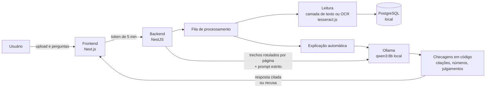

# Document LLM Analyzer

Consulte documentos empresariais ou pessoais (contratos, notas fiscais, artigos, provas)
fazendo perguntas em linguagem natural, **com uma LLM que roda inteiramente na sua
máquina** e que responde **só com o que está escrito no documento**, citando a página de
cada informação.

- **Local por padrão:** OCR, LLM (Ollama), banco de dados e arquivos ficam no computador
  ou servidor onde o app está instalado. Nenhum documento, pergunta ou resposta é enviado
  a serviços externos ([detalhes e como verificar](#privacidade-e-lgpd)).
- **Sem alucinação silenciosa:** cada resposta cita `[p. N]`, e a citação abre o trecho
  exato que o modelo recebeu. O que não pode ser ligado ao documento é recusado ou
  sinalizado pela aplicação, não pelo modelo.
- **Interpretação só quando pedida:** opiniões e conclusões ficam num modo explícito,
  sempre rotulado como interpretação.
- **Português e inglês:** a interface, as explicações e as respostas seguem o idioma de
  cada usuário. Respostas em outro idioma mantêm o original e oferecem "Ver tradução".

> **Versão 1.0.** Pronta para uso pessoal e em empresas. A próxima versão traz a busca
> entre documentos (veja o [roteiro](#roteiro)).

## Instalação

Precisa só do [Docker](https://docs.docker.com/get-docker/) (no Mac, também do app do
[Ollama](https://ollama.com), para usar a GPU da Apple). Em um terminal:

```bash
git clone https://github.com/henriqueizar/Document_Analyzer_LLM
```

```bash
cd Document_Analyzer_LLM/deploy && ./install.sh
```

O instalador faz três perguntas (o endereço de acesso, onde roda a LLM e o modelo), gera
todas as senhas, baixa o modelo e sobe o aplicativo. No fim, mostra o endereço e um
**código de instalação**: abra o endereço e crie a conta de administrador com ele. Usando
sozinho, essa é a sua conta; numa empresa, o administrador cadastra as outras pessoas.

A instalação já vem com HTTPS local, reinício automático, **backup diário automático**,
rede sem saída para a internet e um comando para recuperar a senha do administrador.
Passo a passo, certificado, backup, atualização e problemas comuns:
[`docs/implantacao.md`](docs/implantacao.md).

### Onde foi testado

| Sistema | LLM | Situação |
| --- | --- | --- |
| macOS | Ollama nativo (GPU da Apple) | **Testado** pelo autor: instalação, HTTPS, perguntas respondidas |
| Linux | Ollama nativo | **Testado** em ambiente automatizado, com um substituto da LLM: instalação limpa, fluxo completo, isolamento de rede, recuperação após falha e reinício, backup e restauração |
| Linux com GPU NVIDIA | Ollama no Docker (`gpu`) | **Não testado** (sem GPU disponível); a configuração segue a documentação do Docker e do Ollama |
| Qualquer sistema, só CPU | Ollama no Docker (`cpu`) | **Não testado** com um modelo real |
| Windows | — | **Não testado**; o instalador é um script bash e exigiria o WSL2 |

### Para desenvolver

Pré-requisitos: Node.js 20.12+ (22 LTS recomendado), Docker e [Ollama](https://ollama.com).
No macOS, use o app nativo do Ollama, que usa a GPU da Apple; o Docker no macOS não usa.

```bash
git clone https://github.com/henriqueizar/Document_Analyzer_LLM
cd Document_Analyzer_LLM
cp backend/.env.example backend/.env
cp frontend/.env.example frontend/.env.local
```

Preencha `BACKEND_JWT_SECRET` com o **mesmo** valor nos dois arquivos e `NEXTAUTH_SECRET`
com outro valor (gere ambos com `openssl rand -base64 32`). Depois:

```bash
ollama pull qwen3:8b
```

```bash
cd backend && docker compose up -d && npm install && npm run start:dev
```

```bash
cd frontend && npm install && npm run dev
```

Abra http://localhost:3001. Na primeira execução, o app pede para criar a conta de
administrador, com o código de instalação que o backend mostra no terminal
(`Setup code: XXXX-XXXX`). Esqueceu a senha? `cd backend && npm run reset-password -- <e-mail>`.

O `qwen3:8b` (~5 GB) cabe num Mac de 16 GB. Com 8 GB de RAM, use `qwen3:4b` ou
`gemma3:4b` em `LLM_MODEL`, no `backend/.env`. Para Ollama em Docker (CPU ou GPU NVIDIA),
testes e detalhes de arquitetura, veja [`docs/desenvolvimento.md`](docs/desenvolvimento.md).


## Em números

| | |
| --- | --- |
| Respostas factuais corretas e com a página certa (modelo real, qwen3:8b) | **16/16** |
| Recusas corretas para o que não está no documento ou exige julgamento | **9/11** na execução real; as 2 falhas foram corrigidas e passam ao reproduzir as respostas contra o código atual |
| Tempo mediano por pergunta (qwen3:8b local, no Mac do autor) | **1,8 s** |
| Conexões para fora da instalação durante o uso | **0** de todas as tentativas registradas pelo aplicativo no fluxo completo (`deploy/verify-egress.sh`), com uma tentativa de controle provando que o registro funciona |
| Modos de falha da LLM documentados, cada um com defesa e teste | **10** |
| Testes automatizados | de **5** (gerados pelos frameworks) para **258** unitários + **32** ponta a ponta da API |
| Reparo de fontes sem mapa de caracteres | **0** linhas alteradas indevidamente em 1.051 linhas de 55 PDFs |
| Idiomas (interface, explicações e respostas) | **2** (português e inglês) |

Números da execução de 12/11/2026 de `npm run eval:llm` (27 casos com documentos
fictícios). A execução completa com o código atual está pendente.

## Como funciona



1. O documento é lido em segundo plano: a camada de texto do PDF quando existe, OCR
   (português e inglês) nas páginas digitalizadas e nas imagens.
2. A LLM local escreve uma explicação, no idioma de quem enviou o documento.
3. Cada pergunta recebe os trechos relevantes, rotulados com a página, e um prompt que
   proíbe conhecimento externo. A resposta passa por checagens determinísticas antes de
   ser mostrada.

## Decisões contra alucinação

Cada defesa abaixo nasceu de uma falha observada com o modelo real (qwen3:8b) e é coberta
por testes. Nenhuma técnica elimina alucinações; estas reduzem as alucinações e tornam o
restante visível.

| Problema observado | Defesa |
| --- | --- |
| O endpoint compatível com OpenAI do Ollama ignorava o tamanho de contexto e truncava documentos longos em silêncio | API nativa `/api/chat` com `num_ctx` explícito; documentos longos enviam só os trechos relevantes (BM25 + referências como "cláusula 8") |
| O modelo citou o IPCA na página 4, mas a cláusula está na página 3 | A aplicação confere cada citação contra o texto da página citada e corrige a página quando outra a sustenta claramente |
| Respostas sem citação, ou com todas as citações empilhadas no fim | Frases sem citação recebem a página do trecho que claramente as sustenta; resposta que não pode ser ligada ao documento vira recusa |
| Números que não estão no documento ("seguro de R$ 1.000.000,00") | Todo número de vários dígitos da resposta precisa aparecer nos trechos enviados; senão a resposta é exibida com aviso |
| Em uma prova, o modelo escolhia a alternativa "correta", com uma citação verdadeira do texto da alternativa | No modo estrito, escolher respostas de exercícios e emitir julgamentos é bloqueado. O app responde que isso exigiria interpretação e aponta o modo "Interpretar" |
| Recusa redigida pelo próprio modelo, com uma página enganosa ("não é mencionada… [p. 7]") | Reconhecida e trocada pela frase padrão, sem a página |
| Depois de uma recusa, o modelo passava a recusar tudo | Recusas não são reenviadas como histórico da conversa |
| O modelo recusava dizer o e-mail dos autores ("o documento não diz 'e-mail'") | O prompt distingue *ler* (reconhecer um e-mail, associar o nome ao endereço logo abaixo) de *concluir* |
| Explicações em inglês para documentos em português | Idioma por usuário; resposta no idioma errado é pedida de novo uma vez |
| PDFs com fontes sem mapa de caracteres extraíam `0XOWLDJHQW` em vez de "Multiagent" | Decodificação do deslocamento de 29 caracteres, aplicada só quando o resultado são palavras plausíveis |

Limites conhecidos: os detectores de julgamento e de recusa são baseados em padrões de
frase, não em compreensão; a checagem de citações mede sobreposição de palavras, não
significado; um modelo de 8B parâmetros erra mais do que modelos grandes.

## Avaliação

`npm run eval:llm` roda o modelo real contra documentos fictícios (um contrato, uma prova
e um artigo) e verifica cada resposta: fatos com a página certa, recusas para o que não
está no documento, bloqueio de julgamentos no modo estrito e o modo de interpretação.

| Execução | Modelo | Resultado |
| --- | --- | --- |
| 12/11/2026 | qwen3:8b, contexto 8192, Mac | 25/27: 16/16 factuais com a página certa, 9/11 recusas. As duas falhas (escolher alternativas de prova) motivaram a checagem da pergunta; as respostas que falharam passam quando reproduzidas contra o código atual |

<!-- TODO: nova execução completa com o código atual -->

Além disso: 228 testes unitários (OCR real em arquivos pequenos, banco e LLM simulados)
e 18 testes ponta a ponta da API (login, upload, OCR, perguntas, isolamento entre
usuários).

## Privacidade e LGPD

Durante o uso, nada sai da máquina. A instalação usa a internet uma única vez (pacotes,
imagens Docker e o modelo). Três formas de verificar, sem precisar confiar no autor:

1. **Auditoria por IA:** a página Privacidade do app traz um prompt cético para colar no
   Claude, ChatGPT ou DeepSeek junto com este repositório. Ele pede à IA que *procure*
   vazamentos, e não que confirme que não há nenhum.
2. **Sem internet:** desligue o Wi-Fi e use o app normalmente.
3. **Medida:** `cd deploy && ./verify-egress.sh` sobe uma instalação de produção
   temporária, faz o que os usuários fazem (login, upload com OCR, perguntas, todas as
   páginas, por HTTPS) e registra **toda conexão que o aplicativo tenta**, inclusive as que
   falhariam em silêncio. Falha se alguma for para fora da instalação, e uma tentativa de
   controle feita de propósito prova que o registro está funcionando.

Além disso, o backend **recusa iniciar** se a LLM ou o banco estiverem configurados para
um endereço da internet (ou um modelo "cloud" do Ollama), a menos que isso seja permitido
explicitamente. O aplicativo também desliga a tradução automática e o corretor ortográfico
do navegador, que mandariam o texto da tela para a nuvem. Ele não tem como bloquear os
recursos de IA do próprio navegador (como "Perguntar ao Google sobre esta página").
Detalhes em [`docs/privacidade-lgpd.md`](docs/privacidade-lgpd.md).

O inventário de dados pessoais (o que é guardado, onde e quem acessa) está em
[`docs/privacidade-lgpd.md`](docs/privacidade-lgpd.md). É uma descrição técnica, não um
parecer jurídico de conformidade.

## Segurança

| Ameaça | Proteção |
| --- | --- |
| Alguém cria o administrador antes de quem instalou | Criar o administrador exige o **código de instalação**, mostrado só no servidor |
| Adivinhar senhas | Senhas com hash scrypt; mínimo de 10 caracteres e recusa das mais comuns; bloqueio de 15 minutos após 5 erros na mesma conta ou 30 do mesmo endereço (pega quem testa uma senha em muitas contas) |
| Acesso indevido a documentos | Privados por padrão; compartilhados só com as equipes escolhidas; quem não tem acesso recebe 404; o administrador não vê conteúdo |
| Arquivo disfarçado (um executável renomeado para `.pdf`) | O conteúdo é conferido pelos primeiros bytes antes de qualquer leitura |
| Instruções escondidas num documento (prompt injection) | O modelo não tem ferramentas nem rede: o pior caso é uma resposta errada, e as citações verificáveis ajudam a percebê-la |
| Scripts ou conexões injetados na página | Política de segurança de conteúdo (CSP): o navegador só fala com o próprio app; sem incorporação em outros sites |
| Abuso da LLM | Limite de perguntas por pessoa |
| Rastrear quem viu o quê | Registro de atividades (só metadados), inclusive mudanças de membros de equipe pelo administrador |

Fora do alcance do aplicativo: um computador já comprometido por malware (use
criptografia de disco e mantenha o sistema atualizado) e os recursos de IA do próprio
navegador. Detalhes em [`docs/privacidade-lgpd.md`](docs/privacidade-lgpd.md).

## Roteiro

- [x] Leitura de PDFs e imagens (camada de texto, OCR, reparo de PDFs danificados)
- [x] Explicação automática e chat com citações verificáveis
- [x] Modo estrito e modo de interpretação explícito
- [x] Contas locais (sem login externo), administrador e usuários
- [x] Interface e respostas em português e inglês, com tradução sob demanda
- [x] Equipes e compartilhamento entre setores, com chat próprio para cada pessoa (invisível para quem usa sozinho)
- [x] Painel do administrador: saúde do sistema (banco, Ollama e modelo, fila, falhas, disco), equipes e compartilhamentos, sem acesso ao conteúdo
- [ ] **Versão 2:** busca entre documentos ("onde está o contrato em que o cliente ofereceu X reais?"),
      com a evidência de cada resultado e "nenhum documento" quando for o caso
- [x] Instalação de produção com um comando: HTTPS local, reinício automático, backup diário, rede isolada, recuperação de senha
- [x] Prova de que nada sai da instalação (`deploy/verify-egress.sh`)
- [ ] Dados de demonstração por comando explícito (nunca numa instalação real)
- [x] Exclusão de conta (apagar ou transferir os documentos, com a senha do administrador) e registro de atividades (só metadados)

## Tecnologias

Next.js 16 · NestJS 11 · Prisma 5 + PostgreSQL · Ollama (qwen3:8b) · tesseract.js 7 ·
pdf.js (pdf-parse 2) · pdf-lib

## Autoria

**Autor: Henrique Izar**

Desenvolvi a base deste projeto entre dezembro de 2025 e maio de 2026: a arquitetura frontend/backend, o
upload e a persistência de documentos, a leitura com OCR, a integração com a LLM e o banco
de dados. Com o projeto parado, tive a ideia de melhorá-lo com o
[Claude Code](https://claude.com/claude-code), para estudar a ferramenta e entender os
seus potenciais e os seus limites. O projeto não foi feito por IA: a base, a parte mais
custosa, é minha. O Claude Code refinou, sob a minha direção, com decisões de produto e
revisão a cada etapa. O histórico do git mostra as duas fases.

O que mudou nessa segunda fase:

- **Segurança da informação.** Por engenharia de prompt, instruí o Claude Code a
  verificar, a cada entrega, se algum dado sai da máquina e se o que foi feito segue os
  critérios de segurança da informação da LGPD. Resultado: o login com Google foi
  substituído por contas locais (senhas com hash scrypt, bloqueio após tentativas
  erradas), os arquivos deixaram de ser públicos, cada usuário só acessa os próprios
  documentos, a telemetria e as fontes externas foram removidas, e o app ganhou o
  [inventário de dados pessoais](docs/privacidade-lgpd.md) e o teste automático em
  contêiner sem internet (`verify:offline`).
- **Interface mais intuitiva, mantendo a identidade visual** de terminal (fonte
  pixelada, bordas retas, sem cara de "app de IA"): progresso da leitura em tempo real,
  upload por arrastar, chat no estilo de aplicativo de mensagens, citações clicáveis que
  mostram o trecho e a página do PDF, e interface em português e inglês.
- **Banco de dados estruturado:** migrações versionadas e aplicadas automaticamente ao
  iniciar, status separados para leitura e explicação, as fontes de cada resposta
  guardadas com ela (para conferência) e traduções armazenadas para não serem refeitas.
- **Uso de recursos.** OCR e LLM são pesados, então:
  - documentos são processados em segundo plano, um por vez, e o upload responde na
    hora; o trabalho interrompido é retomado quando o servidor reinicia;
  - documentos longos enviam ao modelo só os trechos relevantes (BM25), em vez do
    documento inteiro; o tamanho de contexto é aplicado de fato (a API compatível com
    OpenAI o ignorava); o modo de raciocínio do modelo fica desligado e o histórico da
    conversa tem orçamento fixo;
  - PDFs são lidos e renderizados em memória, sem ImageMagick/Ghostscript nem arquivos
    temporários, e só as páginas sem texto passam pelo OCR;
  - no Mac, o Ollama roda nativo para usar a GPU (no Docker, rodaria só na CPU);
  - perguntas que o modo estrito não pode responder são recusadas antes de chamar o
    modelo.
- **Engenharia de prompt com medição.** Os prompts foram refinados em muitas rodadas,
  sempre medidas com a avaliação automatizada (`npm run eval:llm`) rodando o modelo
  real. Cada falha observada virou um caso de teste e, quando o prompt não bastava, uma
  checagem em código (veja [Decisões contra alucinação](#decisões-contra-alucinação)).
- **Testes:** dos 5 testes iniciais gerados pelos frameworks para 228 testes unitários,
  18 testes ponta a ponta da API e a avaliação do modelo.
- **Robustez da leitura:** PDFs danificados, digitalizações em JPEG 2000, nomes de
  arquivo com acentos e fontes sem mapa de caracteres.

### Limites observados do Claude Code

Também anotei onde a ferramenta errou ou dependeu de mim:

- Instruções de atualização incompletas: faltou regenerar o cliente do Prisma depois de
  uma migração, e o app quebrou na minha máquina. A correção foi automatizar
  (`npm run db:update` ao iniciar) e testar o caminho de atualizar uma instalação
  existente.
- O ambiente dele não tinha a LLM real: cada ajuste de prompt dependia de eu rodar a
  avaliação no meu Mac. Uma regra nova para um caso (e-mails de autores) causou uma
  regressão em outro (escolha de alternativas de prova), percebida só pela avaliação.
- Correções que tratavam um sintoma: uma lista de frases para bloquear questões de prova
  resolvia o caso, mas não a categoria. Questionei, e a solução foi revista para algo
  mais honesto (responder que a pergunta exige interpretação, em vez de dizer que a
  informação não existe).
