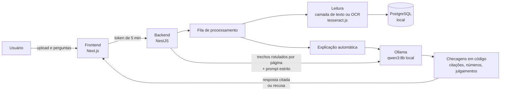

# Document LLM Analyzer

Consulte documentos empresariais ou pessoais (contratos, notas fiscais, artigos, provas)
fazendo perguntas em linguagem natural, **com uma LLM que roda inteiramente na sua
máquina** e que responde **só com o que está escrito no documento**, citando a página de
cada informação.

- **Local por padrão:** OCR, LLM (Ollama), banco de dados e arquivos ficam no computador
  ou servidor onde o app está instalado. Nenhum documento, pergunta ou resposta é enviado
  a serviços externos ([detalhes e como verificar](#privacidade-e-lgpd)).
- **Sem alucinação silenciosa:** cada resposta cita `[p. N]`, e a citação abre o trecho
  exato que o modelo recebeu. O que não pode ser ligado ao documento é recusado ou
  sinalizado pela aplicação, não pelo modelo.
- **Interpretação só quando pedida:** opiniões e conclusões ficam num modo explícito,
  sempre rotulado como interpretação.
- **Português e inglês:** a interface, as explicações e as respostas seguem o idioma de
  cada usuário. Respostas em outro idioma mantêm o original e oferecem "Ver tradução".

> Status: em desenvolvimento ativo. Veja o [roteiro](#roteiro).

## Como funciona



1. O documento é lido em segundo plano: a camada de texto do PDF quando existe, OCR
   (português e inglês) nas páginas digitalizadas e nas imagens.
2. A LLM local escreve uma explicação, no idioma de quem enviou o documento.
3. Cada pergunta recebe os trechos relevantes, rotulados com a página, e um prompt que
   proíbe conhecimento externo. A resposta passa por checagens determinísticas antes de
   ser mostrada.

## Decisões contra alucinação

Cada defesa abaixo nasceu de uma falha observada com o modelo real (qwen3:8b) e é coberta
por testes. Nenhuma técnica elimina alucinações; estas reduzem as alucinações e tornam o
restante visível.

| Problema observado | Defesa |
| --- | --- |
| O endpoint compatível com OpenAI do Ollama ignorava o tamanho de contexto e truncava documentos longos em silêncio | API nativa `/api/chat` com `num_ctx` explícito; documentos longos enviam só os trechos relevantes (BM25 + referências como "cláusula 8") |
| O modelo citou o IPCA na página 4, mas a cláusula está na página 3 | A aplicação confere cada citação contra o texto da página citada e corrige a página quando outra a sustenta claramente |
| Respostas sem citação, ou com todas as citações empilhadas no fim | Frases sem citação recebem a página do trecho que claramente as sustenta; resposta que não pode ser ligada ao documento vira recusa |
| Números que não estão no documento ("seguro de R$ 1.000.000,00") | Todo número de vários dígitos da resposta precisa aparecer nos trechos enviados; senão a resposta é exibida com aviso |
| Em uma prova, o modelo escolhia a alternativa "correta", com uma citação verdadeira do texto da alternativa | No modo estrito, escolher respostas de exercícios e emitir julgamentos é bloqueado. O app responde que isso exigiria interpretação e aponta o modo "Interpretar" |
| Recusa redigida pelo próprio modelo, com uma página enganosa ("não é mencionada… [p. 7]") | Reconhecida e trocada pela frase padrão, sem a página |
| Depois de uma recusa, o modelo passava a recusar tudo | Recusas não são reenviadas como histórico da conversa |
| O modelo recusava dizer o e-mail dos autores ("o documento não diz 'e-mail'") | O prompt distingue *ler* (reconhecer um e-mail, associar o nome ao endereço logo abaixo) de *concluir* |
| Explicações em inglês para documentos em português | Idioma por usuário; resposta no idioma errado é pedida de novo uma vez |
| PDFs com fontes sem mapa de caracteres extraíam `0XOWLDJHQW` em vez de "Multiagent" | Decodificação do deslocamento de 29 caracteres, aplicada só quando o resultado são palavras plausíveis |

Limites conhecidos: os detectores de julgamento e de recusa são baseados em padrões de
frase, não em compreensão; a checagem de citações mede sobreposição de palavras, não
significado; um modelo de 8B parâmetros erra mais do que modelos grandes.

## Avaliação

`npm run eval:llm` roda o modelo real contra documentos fictícios (um contrato, uma prova
e um artigo) e verifica cada resposta: fatos com a página certa, recusas para o que não
está no documento, bloqueio de julgamentos no modo estrito e o modo de interpretação.

| Execução | Modelo | Resultado |
| --- | --- | --- |
| 12/11/2026 | qwen3:8b, contexto 8192, Mac | 25/27. As duas falhas (escolher alternativas de prova) motivaram a checagem da pergunta; as respostas que falharam passam quando reproduzidas contra o código atual |

<!-- TODO: nova execução completa com o código atual -->

Além disso: 228 testes unitários (OCR real em arquivos pequenos, banco e LLM simulados)
e 18 testes ponta a ponta da API (login, upload, OCR, perguntas, isolamento entre
usuários).

## Privacidade e LGPD

Durante o uso, nada sai da máquina. A instalação usa a internet uma única vez (pacotes,
imagens Docker e o modelo). Três formas de verificar, sem precisar confiar no autor:

1. **Auditoria por IA:** a página Privacidade do app traz um prompt cético para colar no
   Claude, ChatGPT ou DeepSeek junto com este repositório. Ele pede à IA que *procure*
   vazamentos, e não que confirme que não há nenhum.
2. **Sem internet:** desligue o Wi-Fi e use o app normalmente.
3. **Automática:** `npm run verify:offline` (no `backend`) roda o fluxo completo num
   contêiner Docker sem rota para a internet, depois de provar que o contêiner não alcança
   nenhum host externo.

O inventário de dados pessoais (o que é guardado, onde e quem acessa) está em
[`docs/privacidade-lgpd.md`](docs/privacidade-lgpd.md). É uma descrição técnica, não um
parecer jurídico de conformidade.

## Como rodar

Pré-requisitos: Node.js 20.12+ (22 LTS recomendado), Docker e [Ollama](https://ollama.com).
No macOS, use o app nativo do Ollama, que usa a GPU da Apple; o Docker no macOS não usa.

```bash
git clone https://github.com/henriqueizar/Document_Analyzer_LLM
cd Document_Analyzer_LLM
cp backend/.env.example backend/.env
cp frontend/.env.example frontend/.env.local
```

Preencha `BACKEND_JWT_SECRET` com o **mesmo** valor nos dois arquivos e `NEXTAUTH_SECRET`
com outro valor (gere ambos com `openssl rand -base64 32`). Depois:

```bash
ollama pull qwen3:8b
```

```bash
cd backend && docker compose up -d && npm install && npm run start:dev
```

```bash
cd frontend && npm install && npm run dev
```

Abra http://localhost:3001. Na primeira execução, o app pede para criar a conta de
administrador (se você vai usar sozinho, é a sua conta).

O `qwen3:8b` (~5 GB) cabe num Mac de 16 GB. Com 8 GB de RAM, use `qwen3:4b` ou
`gemma3:4b` em `LLM_MODEL`, no `backend/.env`. Para Ollama em Docker (CPU ou GPU NVIDIA),
testes e detalhes de arquitetura, veja [`docs/desenvolvimento.md`](docs/desenvolvimento.md).

## Roteiro

- [x] Leitura de PDFs e imagens (camada de texto, OCR, reparo de PDFs danificados)
- [x] Explicação automática e chat com citações verificáveis
- [x] Modo estrito e modo de interpretação explícito
- [x] Contas locais (sem login externo), administrador e usuários
- [x] Interface e respostas em português e inglês, com tradução sob demanda
- [ ] Equipes e compartilhamento entre setores (invisível para quem usa sozinho)
- [ ] Painel do administrador: equipes e saúde do sistema, sem acesso ao conteúdo
- [ ] Busca entre documentos ("onde está o contrato em que o cliente ofereceu X reais?"),
      com a evidência de cada resultado e "nenhum documento" quando for o caso
- [ ] Dados de demonstração por comando explícito (nunca numa instalação real)
- [ ] Exclusão de conta com transferência de documentos e log de auditoria (só metadados)

## Tecnologias

Next.js 16 · NestJS 11 · Prisma 5 + PostgreSQL · Ollama (qwen3:8b) · tesseract.js 7 ·
pdf.js (pdf-parse 2) · pdf-lib

---

Desenvolvido por Henrique Izar, com auxílio de ferramentas de IA (ChatGPT e Claude Code).
